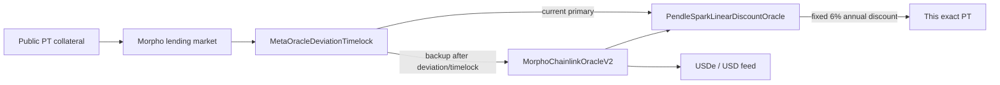

# Oracle investigation — the valuation-versus-escape wedge

Snapshot: `fulcrum-dab2ca7e9ba2a333`, captured 10 October 2026.

## Question

Does Morpho value this PT collateral using the same live Pendle exit economics
that an investor faces when reducing the position?

## Answer

**No: the direct dependency is refuted by the deployed contract configuration.**

The Morpho market points to oracle `0xF8b2...1b08`. Its runtime bytecode is
an EIP-1167 minimal proxy. The proxy delegates to `MetaOracleDeviationTimelock`
and currently selects its primary oracle.

## Observed on-chain configuration

| Item | Observed result |
| --- | --- |
| Current oracle path | Primary |
| Primary feed | `PendleSparkLinearDiscountOracle` |
| PT configured in that feed | selected PT token `0xB195...9390` |
| Primary annual discount | 6% |
| Primary direct live Pendle AMM feed | None |
| Backup additional feed | `USDe / USD` |
| Meta-oracle deviation threshold | 0.75% |
| Challenge timelock | 16 hours |
| Healing timelock | 24 hours |
| Current deviation state | Not deviant |

The primary uses a formulaic PT discount, while the backup adds a USDe/USD
feed. The meta-oracle can move between them under its on-chain challenge and
timelock rules.

## Why this changes the risk result

The live Pendle exit quote and current Morpho price happened to be close, but
the contract trace shows that close prices do not establish a causal link.

For the saved snapshot, a conditional 0.5% underlying-reference shock plus a
1% worse PT exit discount produces:

| Quantity | Result |
| --- | ---: |
| Modelled reference equity loss | 11.31% |
| Morpho health factor under the observed active primary | 1.053 |
| Liquidation triggered by the model | No |

This is the core FULCRUM finding: **the exit can become materially worse while
the active lending valuation remains calm.** It is an escape-risk problem,
not automatically a liquidation-risk problem.

## Evidence method and limits

FULCRUM used read-only Ethereum RPC calls to read the proxy implementation,
meta-oracle state, oracle configuration getters, and feed configuration. It
cross-checked fixed dependency contract identities against verified source
records and saves source links in the evidence snapshot.

The result captures the configuration at one point in time. It does not
predict governance actions, future challenges, or whether an exit quote stays
available. It also does not include liquidation auction costs or a USD gas
estimate.

The health calculation uses PT quantity, the oracle's USDC/PT price, USDC debt
and LLTV. The earlier 1.054 figure used API USD collateral marks; the corrected
native-unit calculation is 1.05332097. The 11.31% loss is a conditional change
in reference equity, not a simulated full-size execution. These distinctions
are shown beside the results in the interface.
